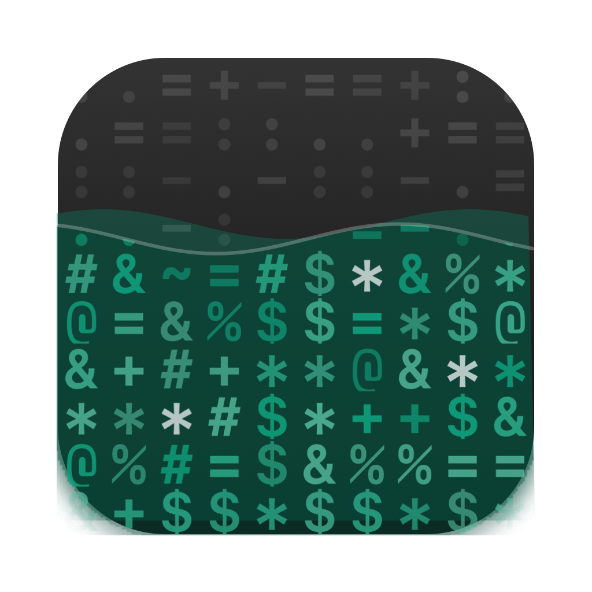
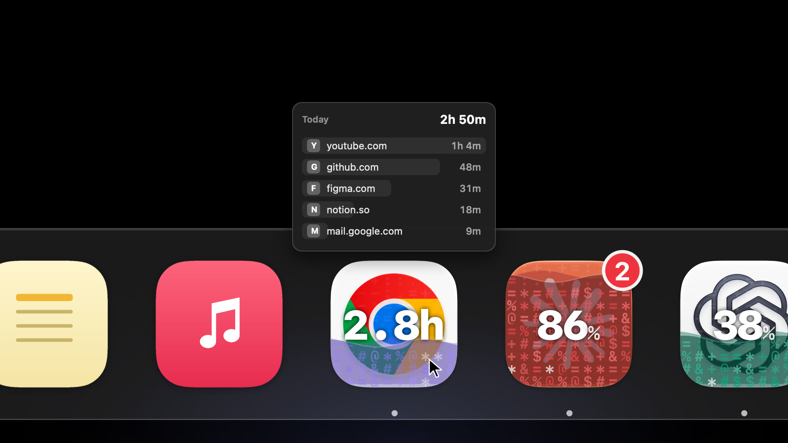
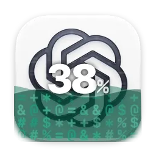
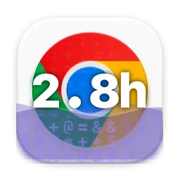
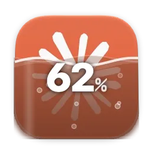
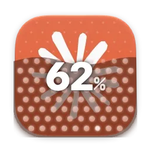
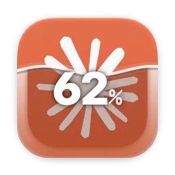

<div align="center">



# Dock Usage

Your Claude and ChatGPT limits, disk, Trash and browser time, drawn right on their Dock icons.

**[Website](https://dockusage.dorara.app)** · **[Download](https://github.com/t42ji2ji/dock-usage/releases/latest/download/DockUsage.dmg)** · [中文](README.zh-TW.md)

<a href="https://dockusage.dorara.app"></a>

</div>

## What it shows

| | |
|:-:|---|
|   | **Claude and ChatGPT**: fills with your 5-hour limit, side ticks for the week, red past 80%. Read from Claude Code and Codex. |
|  | **Sessions waiting**: running Claude Code in [cmux](https://cmux.com)? A red dot counts tabs that finished or need you. |
|   | **Disk and Trash**: Finder fills with your disk, the Trash with what's in it (full at 30). |
|  | **Browser time**: Chrome, Arc, Edge, Brave and ego lite fill with today's time (full at 8 h). Hover for top sites. |
|  | **Latest notification**: hover an app to see the last thing it told you. |

<div align="center">
   
<br><sub>Four looks: ASCII · Liquid · LED · Glow</sub>
</div>

## Install

Download [DockUsage.dmg](https://github.com/t42ji2ji/dock-usage/releases/latest/download/DockUsage.dmg), drag it into Applications and open it. The welcome screen walks you through Accessibility access and what to show. macOS 14+, Apple Silicon.

Claude needs a Pro or Max plan; the welcome screen sets up the Claude Code status line for you. ChatGPT needs nothing.

<details>
<summary>Already have a Claude Code status line?</summary>

Add these lines after your script reads its input into `$input`:

```sh
mkdir -p "$HOME/.claude/dock-usage"
printf '%s' "$input" > "$HOME/.claude/dock-usage/claude.json.$$" && mv -f "$HOME/.claude/dock-usage/claude.json.$$" "$HOME/.claude/dock-usage/claude.json"
```
</details>

## Privacy

Everything stays on your Mac. It reads the limit files Claude Code and Codex already write, cmux's notification list, banners shown on screen and today's browser history. It never goes online and never touches your login tokens. The ⌘Tab switcher is not covered, only the Dock.

## Build from source

`./build.sh` builds `build/Dock Usage.app` (Xcode 16 command line tools). Replace the signing identity in `build.sh` and `release.sh` with your own.

---

Inspired by [IconSwapper](https://iconswapper.app/). GPL-3.0. Claude and ChatGPT are trademarks of Anthropic and OpenAI; Dock Usage is not affiliated with either.
