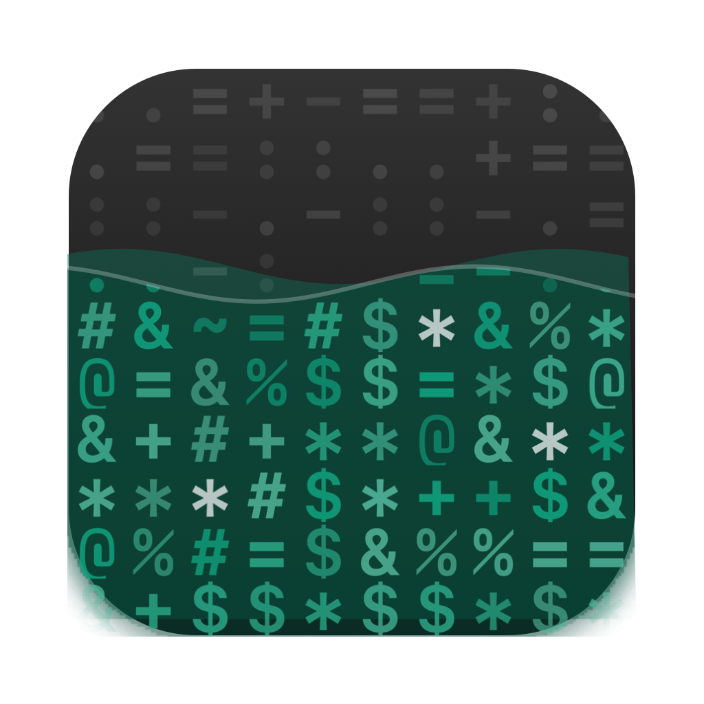
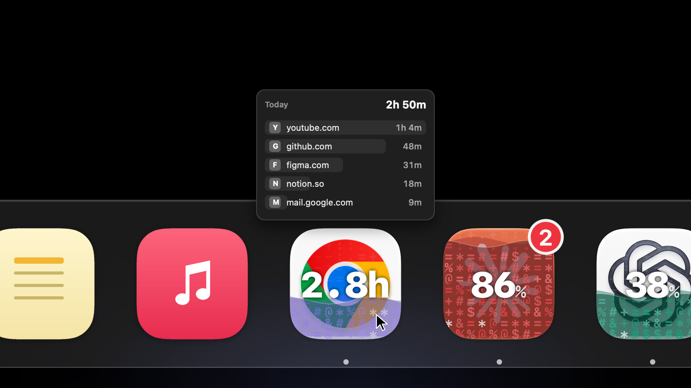
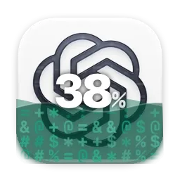
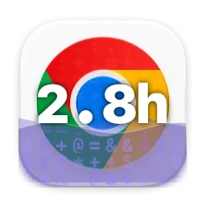
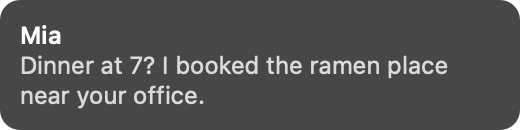
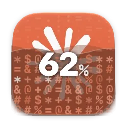
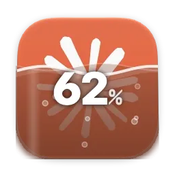
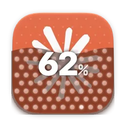
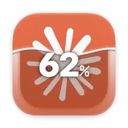

<div align="center">



# Dock Usage

把 Claude 和 ChatGPT 額度、硬碟、垃圾桶、瀏覽器時間，直接畫在 Dock 圖示上。

**[官網](https://dockusage.dorara.app)** · **[下載](https://github.com/t42ji2ji/dock-usage/releases/latest/download/DockUsage.dmg)** · [English](README.md)

<a href="https://dockusage.dorara.app"></a>

</div>

## 顯示什麼

| | |
|:-:|---|
|   | **Claude 和 ChatGPT**：5 小時額度用多少就鋪滿多少，兩側刻度是每週額度，超過 80% 轉紅。從 Claude Code 和 Codex 讀。 |
|  | **有 session 在等你**：在 [cmux](https://cmux.com) 跑 Claude Code 時，紅點是做完或在等你的分頁數。 |
|   | **硬碟和垃圾桶**：Finder 照硬碟用量鋪滿，垃圾桶照裡面的東西鋪滿（30 樣算滿）。 |
|  | **瀏覽器時間**：Chrome、Arc、Edge、Brave、ego lite 照今天用了多久鋪滿（8 小時算滿），滑鼠停上去看前五名網站。 |
|  | **最新通知**：滑鼠停在 app 上，看它最後跳出的通知。 |

<div align="center">
   
<br><sub>四種樣子：ASCII · 液體 · LED 點陣 · 光邊</sub>
</div>

## 安裝

下載 [DockUsage.dmg](https://github.com/t42ji2ji/dock-usage/releases/latest/download/DockUsage.dmg)，拖進「應用程式」後打開，導覽會帶你開輔助使用權限、選要顯示什麼。需要 macOS 14 以上、Apple Silicon。

Claude 需要 Pro 或 Max 方案，導覽會幫你設好 Claude Code 狀態列；ChatGPT 不用設定。

<details>
<summary>已經有自己的 Claude Code 狀態列？</summary>

在腳本把輸入讀進 `$input` 之後加上：

```sh
mkdir -p "$HOME/.claude/dock-usage"
printf '%s' "$input" > "$HOME/.claude/dock-usage/claude.json.$$" && mv -f "$HOME/.claude/dock-usage/claude.json.$$" "$HOME/.claude/dock-usage/claude.json"
```
</details>

## 隱私

資料不離開你的 Mac。只讀 Claude Code 和 Codex 本來就寫在本機的額度檔、cmux 的通知清單、畫面上跳出的通知，和今天的瀏覽紀錄。不連網，也不碰登入憑證。⌘Tab 切換器蓋不到，只有 Dock。

## 從原始碼建置

`./build.sh` 會產生 `build/Dock Usage.app`（需要 Xcode 16 command line tools）。把 `build.sh` 和 `release.sh` 裡的簽名身分換成你自己的。

---

靈感來自 [IconSwapper](https://iconswapper.app/)。GPL-3.0。Claude 和 ChatGPT 是 Anthropic 和 OpenAI 的商標，Dock Usage 與兩家公司無關。
