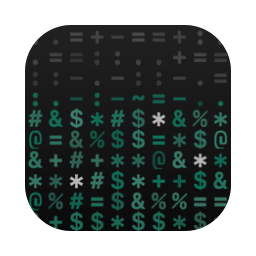
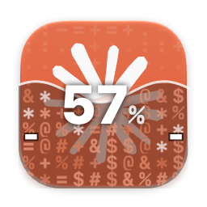
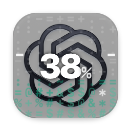

<div align="center">



# Dock Usage

把 Claude 和 ChatGPT 的用量，直接畫在它們的 Dock 圖示上。

[**下載**](https://github.com/t42ji2ji/dock-usage/releases/latest/download/DockUsage.dmg) · [English](README.md)

 

</div>

## 顯示什麼

**5 小時額度**用掉多少，圖示就從下往上鋪滿多少閃爍的 ASCII 字元，中間的數字是百分比。左右兩側的小刻度是**每週額度**。超過 80% 字元轉紅。

- **Claude**：Claude 方案的額度，從 Claude Code 讀。
- **ChatGPT**：ChatGPT 方案裡 Codex 的額度，從 Codex 讀。

每次用 Claude Code 或 Codex 時數字就會更新。已經過了重置時間的額度會歸零。

### Finder 和垃圾桶的硬碟空間

Finder 圖示照硬碟用了多少鋪滿，中間寫百分比。垃圾桶照裡面有幾樣東西鋪滿，30 樣算滿。

### 滑過 Dock 看最新通知

滑鼠停在 Dock 的 app 上，就能看到它最後跳出的那則通知，例如 LINE 訊息。打開那個 app 就會清掉。只記 Dock Usage 開著時跳到畫面上的通知，而且只存在記憶體裡。

### 在 cmux 裡跑 Claude Code 時的紅點

在 [cmux](https://cmux.com) 裡跑 Claude Code 的話，Claude 圖示右上角會出現紅點和數字（Claude 自己有紅點時改到左上角），代表 cmux 裡有幾個分頁亮著通知：回合做完、要權限、或在等你輸入。點進那些分頁就會消失，不用設定。

## 安裝

1. 下載 [DockUsage.dmg](https://github.com/t42ji2ji/dock-usage/releases/latest/download/DockUsage.dmg)，把 Dock Usage 拖進「應用程式」。
2. 打開它，到 **系統設定 › 隱私權與安全性 › 輔助使用** 允許 Dock Usage。它要靠這個找到圖示在 Dock 裡的位置。允許後如果沒出現，結束它再打開一次。
3. 讓 Claude 和 ChatGPT 留在 Dock 上（開著或釘選都可以）。

Dock Usage 沒有視窗，也沒有自己的 Dock 圖示，登入時自動開啟。要結束或關掉登入時開啟，從「應用程式」再打開它一次。

需要 macOS 14 以上、Apple Silicon。

### Claude：狀態列加幾行

Claude Code 會把方案額度傳給它的[狀態列](https://code.claude.com/docs/en/statusline)指令。Dock Usage 從 `~/.claude/dock-usage/claude.json` 讀，所以要讓狀態列把額度存到那裡。

已經有狀態列腳本的話，在它把輸入讀進 `$input` 之後加上：

```sh
rl=$(echo "$input" | jq -c '.rate_limits // empty' 2>/dev/null)
if [ -n "$rl" ]; then
  mkdir -p "$HOME/.claude/dock-usage"
  echo "$rl" > "$HOME/.claude/dock-usage/claude.json.$$" && mv -f "$HOME/.claude/dock-usage/claude.json.$$" "$HOME/.claude/dock-usage/claude.json"
fi
```

還沒有的話，把上面幾行存成 `~/.claude/dock-usage.sh`，第一行加上 `input=$(cat)`，再在 `~/.claude/settings.json` 加：

```json
"statusLine": { "type": "command", "command": "sh ~/.claude/dock-usage.sh" }
```

需要 `jq`（`brew install jq`）和 Claude Pro 或 Max 方案。

### ChatGPT：不用設定

Codex 會把額度寫進 `~/.codex/sessions` 底下的對話紀錄，Dock Usage 讀最新那份。

## 隱私

Dock Usage 只讀上面這兩個本機檔案，有裝 cmux 的話再讀它的通知清單，以及畫面上跳出的通知橫幅，不連網，也不碰你的登入憑證。

## 限制

- ⌘Tab 切換視窗那排還是原本的圖示，只有 Dock 會顯示。
- Dock 滑出或放大時，疊加層會跟著移動，可能慢一格。

## 從原始碼編譯

需要 Xcode 16 command line tools。

```sh
./build.sh        # 產出 "build/Dock Usage.app"
```

把 `build.sh` 和 `release.sh` 裡的簽名身分換成自己的。

## 授權

GPL-3.0。Claude 和 ChatGPT 是 Anthropic 和 OpenAI 的商標，Dock Usage 與兩家公司無關。
